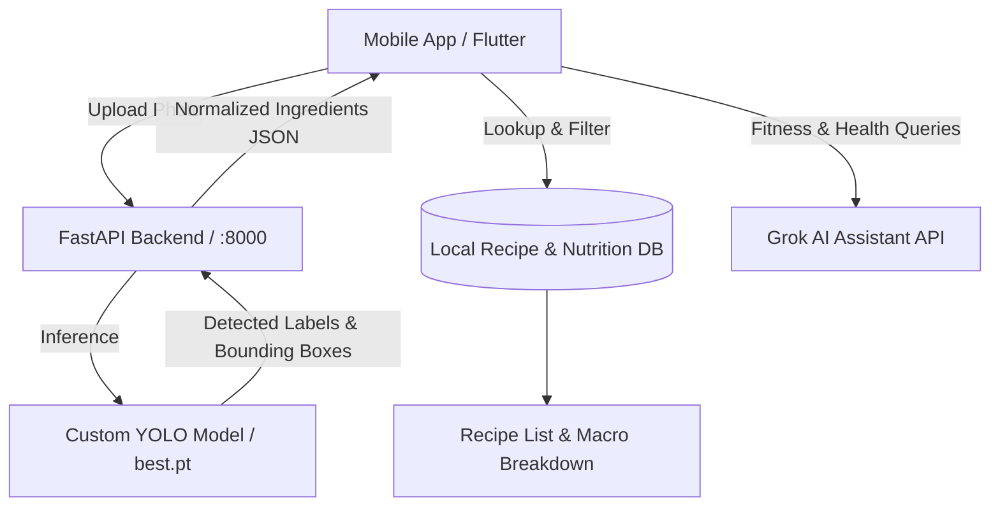

<div align="center">


# 🍳 Cookify

**AI-Powered Ingredient Recognition, Smart Recipe Matching & Nutrition Assistant**

[](https://flutter.dev)
[](https://dart.dev)
[](https://fastapi.tiangolo.com)
[](https://python.org)
[](https://ultralytics.com)
[](https://www.docker.com/)
[](LICENSE)

</div>

---

## 📖 Overview

**Cookify** is an intelligent cooking and dietary companion application designed to eliminate food waste and simplify meal prep. By combining real-time computer vision with comprehensive nutritional analysis and conversational AI, Cookify transforms raw ingredients in your pantry or fridge into healthy, delicious recipes.

Snap a photo of the ingredients you have on hand, let the custom-trained YOLO model detect them instantly, discover matched recipes with calculated macronutrient breakdowns, and chat with an AI Fitness & Nutrition Coach for tailored dietary advice.

---

## ✨ Features

- 📸 **Computer Vision Ingredient Detection**: Snap or upload photos of produce and pantry items; our backend YOLO detection engine recognizes ingredients in milliseconds.
- ✍️ **Flexible Ingredient Management**: Add, adjust, or remove detected items manually, with support for customizable portion sizes in grams.
- 🍲 **Intelligent Recipe Matching**: Discover curated recipes matching your exact available ingredients, with options for strict matching or flexible suggestions.
- 🥗 **Dynamic Macro & Nutrition Calculator**: Computes accurate real-time calories, protein, carbohydrates, and fats based on recipe portions and ingredient weights.
- 🤖 **Grok-Powered AI Fitness Coach**: Built-in conversational AI assistant to answer questions about health, macro tracking, workout nutrition, and meal planning.
- 🎨 **Modern & Fluid Mobile UI**: Built with Flutter and styled with Google Fonts and responsive animations for a smooth, intuitive user experience.
- 🐳 **Containerized & Cross-Platform**: Run the mobile app across iOS, Android, and Web, with a containerized FastAPI backend ready for cloud or local deployment.

---

## 🏗️ Architecture



---

## 📂 Project Structure

```text
Cookify/
├── android/                   # Android native configuration and build scripts
├── ios/                       # iOS native project and assets
├── web/                       # Flutter Web entry point & icons
├── windows/ & linux/ & macos/ # Desktop platform bindings
├── assets/
│   ├── images/                # App branding and header assets
│   ├── nutrition.json         # Macro data per 100g for ingredients
│   └── recipes.json           # Curated recipe library with instructions
├── lib/
│   ├── main.dart              # Main app entry, home screen, detection flow
│   ├── recipe_detail_screen.dart # Detailed recipe view with steps & macros
│   ├── fitness_chat_widget.dart  # AI Fitness Coach chat interface
│   ├── login_screen.dart      # User login & authentication screen
│   ├── signup_screen.dart     # User registration screen
│   └── stub_mlkit.dart        # Platform abstraction helper
├── app.py                     # FastAPI server with PyTorch/Ultralytics YOLO
├── server.py                  # Alternative ONNX Runtime inference server
├── best.pt                    # Trained YOLO model weights
├── classes.json               # Detected label mappings
├── requirements.txt           # Python backend dependencies
├── Dockerfile                 # Docker container specification
├── pubspec.yaml               # Flutter package configuration
└── setup_and_run.ps1          # Windows automated setup script
```

---

## 🚀 Getting Started

### Prerequisites

Ensure you have the following installed on your machine:
- [Flutter SDK](https://docs.flutter.dev/get-started/install) (v3.11+ recommended)
- [Python](https://www.python.org/downloads/) (3.10 or 3.12 recommended)
- [Git](https://git-scm.com/)

---

### 1. Backend Setup (FastAPI & YOLO)

#### Option A: Quick Launch with PowerShell (Windows)
Run the automated setup script to automatically configure a virtual environment, install packages, and launch the server:
```powershell
.\setup_and_run.ps1
```

#### Option B: Manual Setup

1. **Create and activate a virtual environment:**
   ```bash
   # Linux/macOS
   python3 -m venv venv
   source venv/bin/activate

   # Windows (PowerShell)
   python -m venv venv
   .\venv\Scripts\Activate.ps1
   ```

2. **Install dependencies:**
   ```bash
   pip install --upgrade pip
   pip install -r requirements.txt
   ```

3. **Start the API server:**
   ```bash
   uvicorn app:app --host 0.0.0.0 --port 8000 --reload
   ```

The backend API will be available at `http://localhost:8000`. You can inspect the interactive OpenAPI documentation at `http://localhost:8000/docs`.

#### Option C: Docker Setup
Build and run the backend inside a Docker container:
```bash
docker build -t cookify-backend .
docker run -p 8000:7860 cookify-backend
```

---

### 2. Frontend Setup (Flutter)

1. **Navigate to the project root:**
   ```bash
   cd Cookify
   ```

2. **Install Flutter dependencies:**
   ```bash
   flutter pub get
   ```

3. **Configure API Endpoints:**
   - For **Android Emulator**: In [`lib/main.dart`](lib/main.dart), use `http://10.0.2.2:8000/detect`.
   - For **Physical Devices**: Set your host computer's local Wi-Fi IP address (e.g. `http://192.168.1.X:8000/detect`).
   - For **Web & Desktop**: Default `http://localhost:8000/detect` works out of the box.

4. **Run the App:**
   ```bash
   flutter run
   ```

   *(Optional)* To provide your Grok AI API key for the Fitness Chat feature:
   ```bash
   flutter run --dart-define=GROK_API_KEY=your_api_key_here
   ```
   You can also enter your API key directly inside the app settings.

---

## 🛠️ API Reference

### `POST /detect`
Uploads an image file to perform YOLO object detection on ingredients.

- **Request**: `multipart/form-data` with key `file` (image payload: `.jpg`, `.png`, etc.)
- **Response**:
```json
{
  "predictions": [
    {
      "class": "Tomato",
      "confidence": 0.942,
      "bbox": [54, 82, 120, 115]
    },
    {
      "class": "Onion",
      "confidence": 0.887,
      "bbox": [210, 110, 95, 90]
    }
  ]
}
```

---

## 🧪 Tech Stack

- **Frontend**: Flutter, Dart, Google Fonts, Flutter Animate, HTTP, Image Picker, Shared Preferences
- **Backend**: FastAPI, Uvicorn, Python, OpenCV, NumPy, Intel OpenMP
- **Machine Learning**: Ultralytics YOLO, PyTorch, ONNX Runtime
- **DevOps**: Docker

---

## 🤝 Contributing

Contributions, issues, and feature requests are welcome!
1. Fork the Project
2. Create your Feature Branch (`git checkout -b feature/AmazingFeature`)
3. Commit your Changes (`git commit -m 'Add some AmazingFeature'`)
4. Push to the Branch (`git push origin feature/AmazingFeature`)
5. Open a Pull Request

---

## 📄 License

Distributed under the MIT License. See `LICENSE` for more information.
